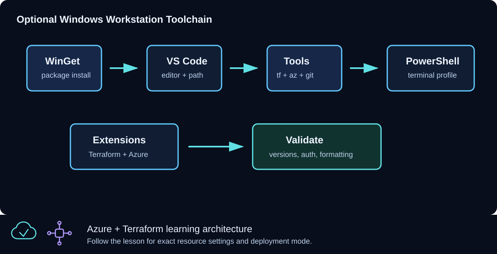

# CLZ-090 - Optional Windows Contributor Workstation Setup



## Goal

Prepare a Windows 10/11 workstation for both learning and repository contribution, including PowerShell 7, Git, VS Code, Terraform, Azure CLI, and the recommended editor extensions. This local-only lesson never contacts or changes Azure.

## Prerequisites

- A supported Windows workstation and permission to install user applications.
- Use an enterprise-approved software channel when WinGet is restricted.

## Architecture

PowerShell is the command surface; Git retrieves and versions the repository; VS Code edits Terraform, Markdown, PowerShell, and YAML; Terraform performs infrastructure operations in later lessons; Azure CLI supplies interactive identity and subscription context. No cloud provider or Azure resource is declared here.

## Resources And Cost

**Relative cost: None.** Only local, freely available tools are used. Enterprise software distribution policies may still apply.

| Component | Purpose and principal cost driver |
|---|---|
| Local tools | PowerShell 7, Git, VS Code, Terraform CLI, and Azure CLI; no Azure billing. |
| VS Code extensions | Terraform, PowerShell, Azure, GitHub Actions, and Markdown authoring support. |

## Inputs

| Input | Required substitution or decision |
|---|---|
| `workstation_os` | Leave `Windows` unless validating the lesson template. |
| `preferred_shell` | Use `PowerShell 7` for commands in this curriculum. |
| `editor` | Use `Visual Studio Code` to match the workspace recommendations. |

Keep real subscription IDs, CIDRs, and secrets in untracked `terraform.tfvars` or environment variables.

## Deploy

Run from the repository root in PowerShell 7:

```powershell
winget --version
winget install --id Microsoft.PowerShell --source winget
winget install --id Git.Git --source winget
winget install --id Microsoft.VisualStudioCode --source winget
winget install --id Hashicorp.Terraform --source winget
winget install --exact --id Microsoft.AzureCLI
./scripts/Test-AzureFromZeroToHeroToolchain.ps1 -Profile Contributor
Set-Location CLZ-090-optional-vscode-terraform-powershell-setup
terraform init -backend=false -lockfile=readonly
terraform fmt -check
terraform validate
terraform plan
```

Installation is optional: omit the WinGet commands when the audit reports the required versions already installed. Reopen PowerShell after installation so updated `PATH` values take effect.

## Validate

```powershell
$commands = 'pwsh','git','code','terraform','az'
$commands | ForEach-Object { Get-Command $_ -ErrorAction Stop | Select-Object Name, Source }
code --list-extensions | Select-String 'hashicorp.terraform|ms-vscode.powershell|markdown'
terraform output -json | ConvertFrom-Json
```

Expected result:

- Every command resolves from `PATH`.
- The required Terraform, PowerShell, and Markdown extensions are listed.
- Terraform reports local workstation metadata and plans no Azure resources.

## Troubleshooting

| Symptom | Resolution |
|---|---|
| A command is not recognized | Close and reopen PowerShell, then inspect `$env:PATH`; reinstall only the missing tool. |
| WinGet is blocked | Use the organization-approved package portal or official installer and rerun the audit. |
| VS Code extensions are missing | Open the repository in VS Code and install its workspace recommendations. |

## Cleanup

```powershell
Set-Location ..
Remove-Item CLZ-090-optional-vscode-terraform-powershell-setup/tfplan -ErrorAction SilentlyContinue
```

There are no Azure resources or Terraform-managed local resources to destroy. Keep the installed tools for later lessons.

## Production Delta

- Use managed software distribution, approved versions, endpoint protection, and a non-administrator daily account on corporate workstations.
- Store Azure credentials in supported identity tooling; never in PowerShell profiles or repository files.

## Exercises

1. Run the Learner and Contributor audits and explain the extra contributor checks.
2. Open a new terminal and prove each required command is resolved from the expected installation path.

## Navigation

<!-- lesson-navigation:start -->
[&larr; Curriculum](../README.md#curriculum) | [Curriculum](../README.md#curriculum) | [CLZ-100 - Terraform Foundations &rarr;](../CLZ-100-foundations/README.md)
<!-- lesson-navigation:end -->
