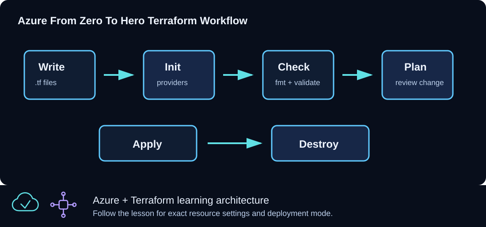

# CLZ-100 - Terraform Foundations



## Goal

Learn configuration, variables, locals, outputs, formatting, validation, and plan review without Azure credentials or Azure resources.

## Prerequisites

- Terraform is available on `PATH`; use CLZ-090 if it is not.
- No Azure login or subscription is required.

## Architecture

The configuration combines three harmless input values into a preview of the naming and tagging model used later. Terraform evaluates expressions and outputs locally; it declares no provider, backend, data source, or resource.

## Resources And Cost

**Relative cost: None.** Terraform performs local evaluation only.

| Component | Purpose and principal cost driver |
|---|---|
| Terraform configuration preview | Derived resource-group name, location, and standard tags; it is output data, not an Azure object. |
| Local plan file | Optional `tfplan` used to practice plan inspection. |

## Inputs

| Input | Required substitution or decision |
|---|---|
| `environment` | Use `dev`, `test`, or `prod` and observe the derived name. |
| `location` | A string used only in the preview; no regional API is called. |
| `name_prefix` | A short naming prefix used to construct the preview. |

Keep real subscription IDs, CIDRs, and secrets in untracked `terraform.tfvars` or environment variables.

## Deploy

Run from the repository root in PowerShell 7:

```powershell
Set-Location CLZ-100-foundations
terraform init -backend=false -lockfile=readonly
terraform fmt -check
terraform validate
terraform plan -out tfplan
terraform show tfplan
```

Do not run `az login`; this lesson is intentionally credential-free.

## Validate

```powershell
terraform providers
$previewPlan = terraform show -json tfplan | ConvertFrom-Json
$previewPlan.output_changes.configuration_preview.after
@($previewPlan.resource_changes).Where({ $null -ne $_ }).Count
```

Expected result:

- `terraform providers` lists no Azure provider requirement.
- `configuration_preview` shows the expected prefix, location, and four standard tags.
- The resource-change count is zero because no resource is declared. The JSON property may be absent.

`terraform output` reads outputs already stored in state. For this plan-only exercise, inspect the proposed outputs in the saved plan instead.

## Troubleshooting

| Symptom | Resolution |
|---|---|
| Terraform tries to use Azure | Confirm you are in `CLZ-100-foundations` and that no untracked `.tf` files were copied into it. |
| Initialization requests a backend | Remove an untracked backend override and rerun with `-backend=false`. |
| The preview name is unexpected | Compare `terraform.tfvars` with the three inputs documented above. |

## Cleanup

```powershell
Remove-Item tfplan -ErrorAction SilentlyContinue
terraform state list
```

`terraform state list` returns no managed resources. No Azure destroy is needed.

## Production Delta

- Adopt an agreed naming/tagging standard and enforce it with policy before creating shared infrastructure.
- Use reviewed modules and remote state only after the underlying Terraform concepts are understood.

## Exercises

1. Change `environment` to `test` and predict the output before replanning.
2. Use `terraform console` to evaluate `local.tags` and `local.prefix`.

## Navigation

<!-- lesson-navigation:start -->
[&larr; CLZ-090 - Optional Windows Contributor Workstation Setup](../CLZ-090-optional-vscode-terraform-powershell-setup/README.md) | [Curriculum](../README.md#curriculum) | [CLZ-110 - Azure CLI and Subscription Readiness &rarr;](../CLZ-110-windows-workstation-setup/README.md)
<!-- lesson-navigation:end -->
