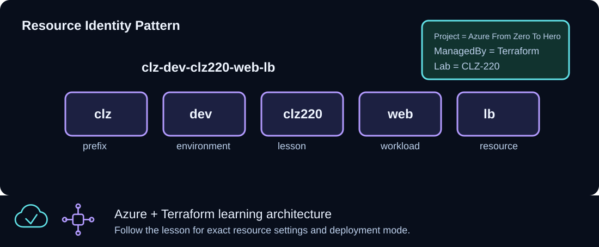

# CLZ-150 - Variables, Locals, and Outputs



## Goal

Separate learner-controlled inputs, derived naming logic, and observable outputs so a small Terraform configuration remains understandable and reusable.

## Prerequisites

- Complete CLZ-140.
- Understand the difference between configuration source and untracked local values.

## Architecture

Typed variables define the public interface, locals derive the immutable CLZ-150 naming and tags, one resource group consumes the derived values, and outputs expose only validation-friendly results.

## Resources And Cost

**Relative cost: Low.** The empty resource group has no direct charge.

| Component | Purpose and principal cost driver |
|---|---|
| Variables | The small public interface: subscription, environment, location, and prefix. |
| Locals | Fixed lesson ID plus derived names/tags. |
| Resource group and outputs | A managed example and observable, nonsensitive results. |

## Inputs

| Input | Required substitution or decision |
|---|---|
| `subscription_id` | Required for Azure plan, apply, and destroy; copy the exact ID returned by Azure CLI. |
| `environment` | Keep `dev` for the lab or choose `test`/`prod` only to study the naming boundary. |
| `location` | Use a region where your subscription has access and sufficient quota. |
| `name_prefix` | Use a short lowercase prefix; resource names derive from it. |

Keep real subscription IDs, CIDRs, and secrets in untracked `terraform.tfvars` or environment variables.

## Deploy

Run from the repository root in PowerShell 7:

```powershell
Set-Location CLZ-150-variables-locals-outputs
if (-not (Test-Path terraform.tfvars)) {
  Copy-Item terraform.tfvars.example terraform.tfvars
}
$subscriptionId = az account show --query id --output tsv
terraform init -lockfile=readonly
terraform fmt -check
terraform validate
terraform plan -var "subscription_id=$subscriptionId" -out tfplan
terraform show tfplan
terraform apply tfplan
```

## Validate

```powershell
terraform output -json | ConvertFrom-Json | Format-List
terraform console
local.prefix
local.tags
exit
```

Expected result:

- Outputs match the selected location and derived resource-group name.
- `local.prefix` includes the fixed `clz150` code.
- The tag map is derived once rather than repeated across resources.

## Troubleshooting

| Symptom | Resolution |
|---|---|
| Terraform rejects an environment | Use one of the values allowed by the variable validation. |
| A local value cannot be overridden | Change its source input; locals intentionally are not public inputs. |
| An output is marked unknown during plan | The value depends on an Azure result that is known only after apply. |

## Cleanup

```powershell
$resourceGroup = terraform output -raw resource_group_name
terraform destroy -var "subscription_id=$subscriptionId"
az group exists --name $resourceGroup
```

Azure CLI returns `false`, and `terraform state list` is empty.

## Production Delta

- Treat module inputs and outputs as versioned interfaces; document breaking changes.
- Mark secret outputs sensitive, but remember that sensitive values can still exist in state.

## Exercises

1. Add a validation for a deliberately constrained prefix and test one invalid value.
2. Create a new nonsensitive output from existing locals without duplicating naming logic.

## Navigation

<!-- lesson-navigation:start -->
[&larr; CLZ-140 - Resource Groups and Tags](../CLZ-140-resource-groups-tags/README.md) | [Curriculum](../README.md#curriculum) | [CLZ-160 - State and Locking Basics &rarr;](../CLZ-160-state-and-locking-basics/README.md)
<!-- lesson-navigation:end -->
