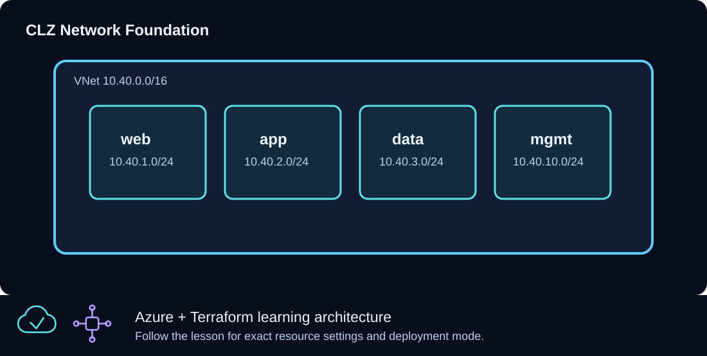

# CLZ-170 - Virtual Network Foundation



## Goal

Build an address plan that separates web, application, data, and management workloads and exposes stable subnet IDs for later patterns.

## Prerequisites

- Complete CLZ-160 and destroy its lab.
- Know which subscription and Azure region will host the network.

## Architecture

One `10.40.0.0/16` virtual network contains four nonoverlapping `/24` subnets: web, app, data, and management. This lesson intentionally has no NSG, route table, VM, or public IP so the address model is easy to inspect before policy is layered on.

## Resources And Cost

**Relative cost: Low.** Virtual networks and subnets have no direct hourly charge; later gateways, peerings, and traffic can be billable.

| Component | Purpose and principal cost driver |
|---|---|
| Resource group | Lifecycle boundary for the lesson. |
| Virtual network | `10.40.0.0/16` address space. |
| Four subnets | Web, app, data, and management segmentation; no workload is deployed. |

## Inputs

| Input | Required substitution or decision |
|---|---|
| `subscription_id` | Required for plan, apply, and destroy; use the exact subscription GUID. |
| `environment` | Keep `dev` for an ephemeral lab unless testing an environment boundary. |
| `location` | Select a supported region with adequate quota. |
| `name_prefix` | Use a short lowercase prefix for derived names. |

Keep real subscription IDs, CIDRs, and secrets in untracked `terraform.tfvars` or environment variables.

## Deploy

Run from the repository root in PowerShell 7:

```powershell
Set-Location CLZ-170-virtual-network-foundation
if (-not (Test-Path terraform.tfvars)) {
  Copy-Item terraform.tfvars.example terraform.tfvars
}
$subscriptionId = az account show --query id --output tsv
terraform init -lockfile=readonly
terraform fmt -check
terraform validate
terraform plan -var "subscription_id=$subscriptionId" -out tfplan
terraform show tfplan
terraform apply tfplan
```

## Validate

```powershell
$resourceGroup = terraform output -raw resource_group_name
$vnet = terraform output -raw vnet_name
az network vnet show --resource-group $resourceGroup --name $vnet --query addressSpace.addressPrefixes --output tsv
az network vnet subnet list --resource-group $resourceGroup --vnet-name $vnet --query '[].{name:name,prefix:addressPrefix}' --output table
```

Expected result:

- The VNet contains `10.40.0.0/16`.
- Exactly four subnets appear with distinct `10.40.x.0/24` prefixes.
- A second Terraform plan reports no changes.

## Troubleshooting

| Symptom | Resolution |
|---|---|
| A subnet prefix overlaps | Correct the address plan before apply; Azure will reject overlapping ranges. |
| A preferred region is unavailable | Change `location`; VNet CIDRs are independent of region. |
| Later peering would overlap | Choose a new nonoverlapping private range before workloads depend on this network. |

## Cleanup

```powershell
$resourceGroup = terraform output -raw resource_group_name
terraform destroy -var "subscription_id=$subscriptionId"
terraform state list
az group exists --name $resourceGroup
```

The state is empty and Azure CLI returns `false`.

## Production Delta

- Allocate CIDRs from an organization-wide IP address management plan.
- Add DNS, DDoS decisions, route tables, NSGs, flow logs, and hub connectivity according to the platform design.

## Exercises

1. Add a fifth temporary subnet without overlapping existing ranges and review the plan.
2. Draw a peering candidate and prove its address space does not overlap `10.40.0.0/16`.

## Navigation

<!-- lesson-navigation:start -->
[&larr; CLZ-160 - State and Locking Basics](../CLZ-160-state-and-locking-basics/README.md) | [Curriculum](../README.md#curriculum) | [CLZ-180 - Network Security Groups &rarr;](../CLZ-180-network-security-groups/README.md)
<!-- lesson-navigation:end -->
