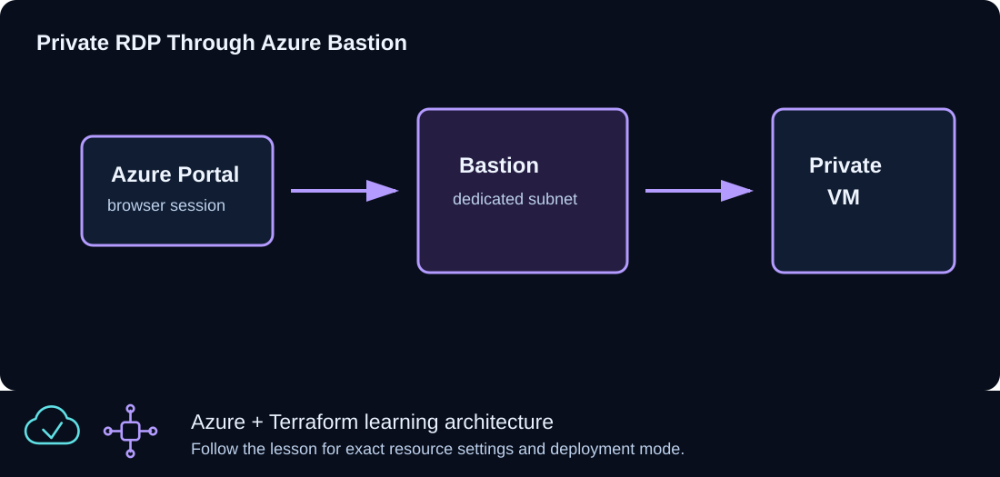

# CLZ-210 - Azure Bastion RDP



## Goal

Administer a Windows VM over private IP through Azure Bastion so the workload has no public IP and no direct Internet RDP path.

## Prerequisites

- Complete CLZ-200.
- Bastion is available in the chosen region and the subscription permits its public IP and host resources.
- Understand that this lesson intentionally provides no general workload Internet egress.

## Architecture

A dedicated `/26` `AzureBastionSubnet` hosts Azure Bastion and its Standard public IP. The Windows VM remains private in the web subnet; its NSG admits RDP only from the Bastion subnet. There is no NAT Gateway, VM public IP, or general outbound path.

## Resources And Cost

**Relative cost: High.** Azure Bastion's hourly charge is the dominant cost, followed by the Windows VM, disk, and Bastion public IP.

| Component | Purpose and principal cost driver |
|---|---|
| Azure Bastion and Standard public IP | Browser/native-client management service billed while deployed. |
| Private Windows VM and disk | No public IP; compute remains billable while allocated. |
| VNet, Bastion subnet, web subnet, and NSG | Separates management ingress from the workload network. |

## Inputs

| Input | Required substitution or decision |
|---|---|
| `subscription_id` | Required for plan, apply, and destroy; use the exact subscription GUID. |
| `environment` | Keep `dev` for an ephemeral lab unless testing an environment boundary. |
| `location` | Select a supported region with adequate quota. |
| `name_prefix` | Use a short lowercase prefix for derived names. |
| `admin_username` | Nonreserved Windows administrator name. |
| `vm_size` | Small supported size with available quota. |

Keep real subscription IDs, CIDRs, and secrets in untracked `terraform.tfvars` or environment variables.

## Deploy

Run from the repository root in PowerShell 7:

```powershell
Set-Location CLZ-210-azure-bastion-rdp
if (-not (Test-Path terraform.tfvars)) {
  Copy-Item terraform.tfvars.example terraform.tfvars
}
$subscriptionId = az account show --query id --output tsv
terraform init -lockfile=readonly
terraform fmt -check
terraform validate
terraform plan -var "subscription_id=$subscriptionId" -out tfplan
terraform show tfplan
terraform apply tfplan
```

## Validate

```powershell
$resourceGroup = terraform output -raw resource_group_name
az network bastion show --resource-group $resourceGroup --name (terraform output -raw bastion_name) --query '{state:provisioningState,sku:sku.name}' --output table
az vm show --ids (terraform output -raw private_windows_vm_id) --show-details --query '{name:name,privateIp:privateIps,publicIp:publicIps,powerState:powerState}' --output json
az network public-ip list --resource-group $resourceGroup --query '[].{name:name,ip:ipAddress}' --output table
```

Expected result:

- Bastion is `Succeeded`.
- The Windows VM is running with a private IP and no public IP.
- The only public IP belongs to Bastion; connect through the portal's Bastion action and not direct RDP.

## Troubleshooting

| Symptom | Resolution |
|---|---|
| Bastion deployment takes a long time | Wait for provisioning to finish; do not interrupt an active create unless Azure reports failure. |
| RDP through Bastion fails | Check the VM power state, NSG source/subnet rule, credentials, and guest RDP service. |
| Windows activation or updates fail | This private VM has no general Internet egress by design; activation/patch services may require an approved platform route, NAT, or firewall in a real environment. |

## Cleanup

```powershell
$resourceGroup = terraform output -raw resource_group_name
terraform destroy -var "subscription_id=$subscriptionId"
az group exists --name $resourceGroup
```

Bastion, its public IP, the private VM, and the network are gone. Destroy can take several minutes.

## Production Delta

- Add an explicit, filtered outbound design for Windows activation, updates, endpoint protection, and artifact retrieval; do not rely on implicit default outbound access.
- Use Entra ID/native-client controls where appropriate, Just-In-Time policy, session monitoring, hardened images, and least-privilege administration.

## Exercises

1. Prove from Azure CLI that no public IP is attached to the VM NIC.
2. Compare the cost and trust boundary of Bastion with VPN-based administration.

## Navigation

<!-- lesson-navigation:start -->
[&larr; CLZ-200 - Windows VM IIS Bootstrap](../CLZ-200-windows-vm-iis-bootstrap/README.md) | [Curriculum](../README.md#curriculum) | [CLZ-220 - Standard Load Balancer for Windows &rarr;](../CLZ-220-standard-load-balancer-windows/README.md)
<!-- lesson-navigation:end -->
