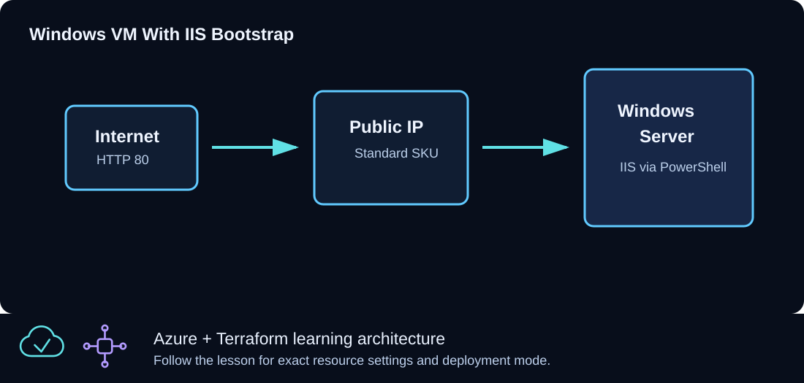

# CLZ-250 - For Each with Windows VMs



## Goal

Give Windows VMs durable, human-readable Terraform identities by creating them from a typed map whose keys, VM sizes, and role values all affect the result.

## Prerequisites

- Complete CLZ-240 and understand the limitations of positional `count` indexes.
- Quota and budget for every entry in `vm_definitions`.
- A current administrator public IPv4 `/32` for this intentional public-IP lesson.

## Architecture

`for_each` applies the same VM, NIC, disk, and public-IP pattern to a map. Map keys become stable Terraform addresses and name fragments. Each value supplies its own `vm_size` and `role`; the role is also written to Azure tags.

## Resources And Cost

**Relative cost: High.** Every map entry creates a Windows VM, disk, NIC, and public IP; sizes can produce different per-entry costs.

| Component | Purpose and principal cost driver |
|---|---|
| Named Windows VMs and disks | One set per map key; VM size controls most cost. |
| Named NICs and public IPs | Keyed dependencies and intentional teaching egress. |
| Shared VNet and NSG | RDP is scoped to one administrator `/32`. |
| Role tags | Value metadata demonstrates why a typed object is more useful than a set of names. |

## Inputs

| Input | Required substitution or decision |
|---|---|
| `subscription_id` | Required for Azure plan, apply, and destroy; use the exact subscription GUID. |
| `environment` | Keep `dev` for the lab unless testing another environment boundary. |
| `location` | Select a supported region with sufficient quota. |
| `name_prefix` | Use a short lowercase prefix. |
| `admin_username` | One nonreserved Windows administrator name for the example set. |
| `admin_cidr` | Required current public IPv4 `/32`; broad sources fail validation. |
| `vm_definitions` | Required map of objects shaped as `{ vm_size = string, role = string }`; keys must be stable workload names. |

Keep real subscription IDs, CIDRs, domains, endpoint names, and secrets in untracked local files or environment variables.

## Deploy

Run from the repository root in PowerShell 7:

```powershell
Set-Location CLZ-250-for-each-windows-vms
if (-not (Test-Path terraform.tfvars)) {
  Copy-Item terraform.tfvars.example terraform.tfvars
}
$subscriptionId = az account show --query id --output tsv
terraform init -lockfile=readonly
terraform fmt -check
terraform validate
terraform plan -var "subscription_id=$subscriptionId" -out tfplan
terraform show tfplan
terraform apply tfplan
```

## Validate

```powershell
$resourceGroup = terraform output -raw resource_group_name
terraform state list | Select-String '\[".+"\]'
terraform output -json windows_vm_public_ips | ConvertFrom-Json | Format-Table
az vm list --resource-group $resourceGroup --show-details --query '[].{name:name,role:tags.Role,size:hardwareProfile.vmSize,ip:publicIps}' --output table
```

Expected result:

- State addresses contain the map keys rather than numeric positions.
- Azure VM sizes and `Role` tags match each object value.
- The output map uses the same keys and contains one public IP per entry.

## Troubleshooting

| Symptom | Resolution |
|---|---|
| Renaming a key proposes delete/create | Keys are resource identity; use a moved block when a real rename must preserve an object. |
| Terraform reports the wrong object shape | Every value must provide both string attributes: `vm_size` and `role`. |
| One size has no quota | Choose an available size for that map value or reduce the map before apply. |

## Cleanup

```powershell
$resourceGroup = terraform output -raw resource_group_name
terraform destroy -var "subscription_id=$subscriptionId"
terraform state list
az group exists --name $resourceGroup
```

All keyed resources are deleted, state is empty, and Azure CLI returns `false`.

## Production Delta

- Intentional teaching exception: remove VM public IPs and use private administration plus explicit egress.
- Validate role/size policy, use modules for repeated patterns, and preserve key identity with documented moved blocks during refactors.

## Exercises

1. Add a `batch` entry with a different size and role, then predict every new address.
2. Rename one key only in a disposable plan and explain how a moved block would avoid replacement.

## Navigation

<!-- lesson-navigation:start -->
[&larr; CLZ-240 - Count with Windows VMs](../CLZ-240-count-windows-vms/README.md) | [Curriculum](../README.md#curriculum) | [CLZ-260 - Windows VMSS Manual Scaling &rarr;](../CLZ-260-windows-vmss-manual-scaling/README.md)
<!-- lesson-navigation:end -->
