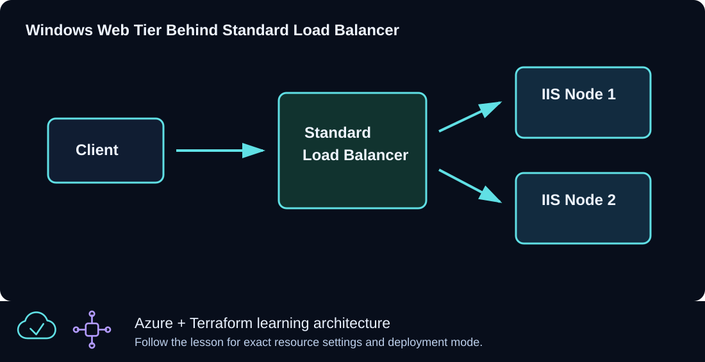

# CLZ-270 - Windows VMSS Autoscaling



## Goal

Attach bounded CPU-driven autoscaling to the Windows IIS VMSS and validate capacity as one coherent object with integer minimum, default, and maximum values.

## Prerequisites

- Complete CLZ-260.
- Quota for the configured maximum capacity.
- Understand Azure Monitor metric aggregation and cooldown periods.

## Architecture

The shared VMSS module supplies the load-balanced IIS tier and explicit outbound path. An Azure Monitor autoscale setting targets the VMSS, scales out above the CPU threshold, and scales in below it while never crossing the validated capacity bounds.

## Resources And Cost

**Relative cost: High.** The autoscale maximum is the budget ceiling; actual VM, disk, public IP, and data charges vary over time.

| Component | Purpose and principal cost driver |
|---|---|
| Windows IIS VMSS and Load Balancer | Scalable application tier created by the shared module. |
| Autoscale setting | CPU rules, cooldowns, and bounded capacity profile. |
| VNet and web NSG | Network and public HTTP teaching path. |

## Inputs

| Input | Required substitution or decision |
|---|---|
| `subscription_id` | Required for Azure plan, apply, and destroy; use the exact subscription GUID. |
| `environment` | Keep `dev` for the lab unless testing another environment boundary. |
| `location` | Select a supported region with sufficient quota. |
| `name_prefix` | Use a short lowercase prefix. |
| `admin_username` | Nonreserved scale-set administrator name. |
| `vm_size` | Uniform Windows size used by the VMSS. |
| `autoscale_capacity` | Required object `{ minimum, default, maximum }`; all values are integers and must satisfy `minimum <= default <= maximum`. |

Keep real subscription IDs, CIDRs, domains, endpoint names, and secrets in untracked local files or environment variables.

## Deploy

Run from the repository root in PowerShell 7:

```powershell
Set-Location CLZ-270-windows-vmss-autoscaling
if (-not (Test-Path terraform.tfvars)) {
  Copy-Item terraform.tfvars.example terraform.tfvars
}
$subscriptionId = az account show --query id --output tsv
terraform init -lockfile=readonly
terraform fmt -check
terraform validate
terraform plan -var "subscription_id=$subscriptionId" -out tfplan
terraform show tfplan
terraform apply tfplan
```

## Validate

The shared VMSS module uses a **Manual** upgrade policy. An IIS extension added to the model may require explicitly updating existing instances. Review the instance model and extension status before expecting healthy HTTP responses:

```powershell
$resourceGroup = terraform output -raw resource_group_name
$scaleSetName = az vmss list --resource-group $resourceGroup --query '[0].name' --output tsv
az vmss list-instances --resource-group $resourceGroup --name $scaleSetName --expand instanceView --output json
# Deliberate Azure change: update these lab instances to the latest model after review.
az vmss update-instances --resource-group $resourceGroup --name $scaleSetName --instance-ids '*'
```

Follow Microsoft's [VMSS application deployment guidance](https://learn.microsoft.com/en-us/azure/virtual-machine-scale-sets/virtual-machine-scale-sets-deploy-app). Wait for successful extension execution and probe health before checking HTTP.

```powershell
$resourceGroup = terraform output -raw resource_group_name
az monitor autoscale show --resource-group $resourceGroup --name (terraform output -raw autoscale_setting_name) --query '{enabled:enabled,capacity:profiles[0].capacity,rules:profiles[0].rules[].metricTrigger.operator}' --output json
(Invoke-WebRequest -Uri (terraform output -raw vmss_load_balancer_url) -UseBasicParsing).StatusCode
terraform plan -var "subscription_id=$subscriptionId" -var 'autoscale_capacity={minimum=3,default=2,maximum=1}'
```

Expected result:

- Autoscale is enabled with the requested string capacities and two metric rules.
- HTTP returns `200` through the Load Balancer.
- The deliberately invalid capacity ordering fails during Terraform validation without changing Azure.

## Troubleshooting

| Symptom | Resolution |
|---|---|
| Autoscale does not react immediately | Metric windows and cooldowns intentionally delay action; inspect metric data and autoscale run history. |
| The capacity object is rejected | Use whole numbers and preserve `minimum <= default <= maximum`. |
| Scale-out hits a subscription limit | Set maximum within verified quota and budget, then reapply the bounds. |

## Cleanup

```powershell
$resourceGroup = terraform output -raw resource_group_name
terraform destroy -var "subscription_id=$subscriptionId"
az group exists --name $resourceGroup
```

The autoscale setting is removed before the VMSS and supporting network resources.

## Production Delta

- Use application and queue metrics where they better represent demand, and test scale behavior with realistic load.
- Add cost alerts, quota headroom, instance warm-up awareness, health-based rollout, and operational dashboards.

## Exercises

1. Create an invalid fractional capacity in a temporary tfvars file and explain the validation error.
2. Generate safe test load, watch metrics, and relate the observed delay to time window and cooldown settings.

## Navigation

<!-- lesson-navigation:start -->
[&larr; CLZ-260 - Windows VMSS Manual Scaling](../CLZ-260-windows-vmss-manual-scaling/README.md) | [Curriculum](../README.md#curriculum) | [CLZ-280 - NAT Gateway Outbound &rarr;](../CLZ-280-nat-gateway-outbound/README.md)
<!-- lesson-navigation:end -->
