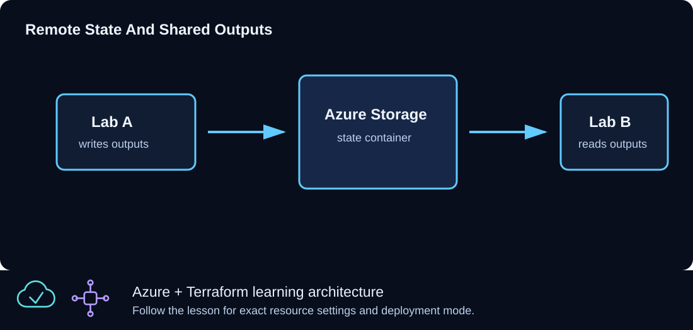

# CLZ-320 - Cross-Environment State



## Goal

Read a documented set of outputs from CLZ-310's Azure Storage-backed state through one required typed object, without copying its placeholder defaults into a deployable configuration.

## Prerequisites

- Complete the entire CLZ-310 bootstrap and remote-state migration.
- Keep the CLZ-310 storage account, container, firewall access, and blob alive.
- Azure AD blob-data permission for the selected identity.

## Architecture

The `terraform_remote_state` data source uses the AzureRM backend with Azure AD authorization. Its four connection values come from `var.remote_state`. CLZ-320 creates its own resource group and exposes only the discovered shared-output keys, demonstrating explicit producer/consumer state ownership.

## Resources And Cost

**Relative cost: Low.** The consumer resource group has no direct charge; backend transaction/storage charges are minimal.

| Component | Purpose and principal cost driver |
|---|---|
| Remote-state data source | Reads, but does not own, the CLZ-310 blob. |
| Consumer resource group | Independent lifecycle proves the consumer can deploy after reading producer outputs. |
| Typed `remote_state` object | Prevents ambiguous parallel strings and rejects placeholder accounts early. |

## Inputs

| Input | Required substitution or decision |
|---|---|
| `subscription_id` | Required for Azure plan, apply, and destroy; use the exact subscription GUID. |
| `environment` | Keep `dev` for the lab unless testing another environment boundary. |
| `location` | Select a supported region with sufficient quota. |
| `name_prefix` | Use a short lowercase prefix. |
| `remote_state` | Required object `{ resource_group_name, storage_account_name, container_name, key }`; copy all four real values from CLZ-310 `backend_configuration`. |

Keep real subscription IDs, CIDRs, domains, endpoint names, and secrets in untracked local files or environment variables.

## Deploy

Run from the repository root in PowerShell 7:

```powershell
Set-Location CLZ-310-remote-state-storage
$remoteState = terraform output -json backend_configuration | ConvertFrom-Json
$remoteState | Format-List
Set-Location ../CLZ-320-cross-environment-state
Copy-Item terraform.tfvars.example terraform.tfvars
# Replace the remote_state object in terraform.tfvars with the four values above.
code terraform.tfvars
$subscriptionId = az account show --query id --output tsv
terraform init -lockfile=readonly
terraform fmt -check
terraform validate
terraform plan -var "subscription_id=$subscriptionId" -out tfplan
terraform show tfplan
terraform apply tfplan
```

CLZ-320 keeps its own local state; it reads CLZ-310 state but never takes ownership of the backend resources.

## Validate

```powershell
terraform output -json shared_output_keys | ConvertFrom-Json
terraform console
data.terraform_remote_state.shared.outputs.backend_configuration
exit
terraform plan -var "subscription_id=$subscriptionId" -var 'remote_state={resource_group_name="x",storage_account_name="replacewithstateaccount",container_name="tfstate",key="clz310.tfstate"}'
```

Expected result:

- The shared key list includes CLZ-310 outputs, including `backend_configuration`.
- Terraform console reads the same real backend metadata from the producer state.
- The deliberate placeholder account fails validation before any Azure change.

## Troubleshooting

| Symptom | Resolution |
|---|---|
| Initialization succeeds but remote state gets 403 | Check Azure AD blob-data access, firewall `/32`, current public IP, and the exact account/container. |
| The blob/key is not found | Use `clz310.tfstate` and the producer output; do not guess a key. |
| An expected output is absent | Apply the current CLZ-310 producer configuration and confirm the remote blob was updated. |

## Cleanup

```powershell
$resourceGroup = terraform output -raw resource_group_name
terraform destroy -var "subscription_id=$subscriptionId"
terraform state list
az group exists --name $resourceGroup
# Only now return to CLZ-310 and migrate/destroy its backend.
```

The consumer resource group is gone and its state is empty. The CLZ-310 backend still exists until its documented migration-back procedure finishes.

## Production Delta

- Prefer narrow, versioned module/service contracts over broad state coupling; remote-state readers can see all producer outputs stored in state.
- Separate producer and consumer identities, state containers/keys, change windows, and failure recovery procedures.

## Exercises

1. Add one harmless producer output, apply CLZ-310, and observe the new key in CLZ-320.
2. Deliberately use a wrong key, interpret the error, and restore the typed object without changing Azure.

## Navigation

<!-- lesson-navigation:start -->
[&larr; CLZ-310 - Remote State Storage](../CLZ-310-remote-state-storage/README.md) | [Curriculum](../README.md#curriculum) | [CLZ-330 - Traffic Manager Global Routing &rarr;](../CLZ-330-traffic-manager-or-front-door/README.md)
<!-- lesson-navigation:end -->
