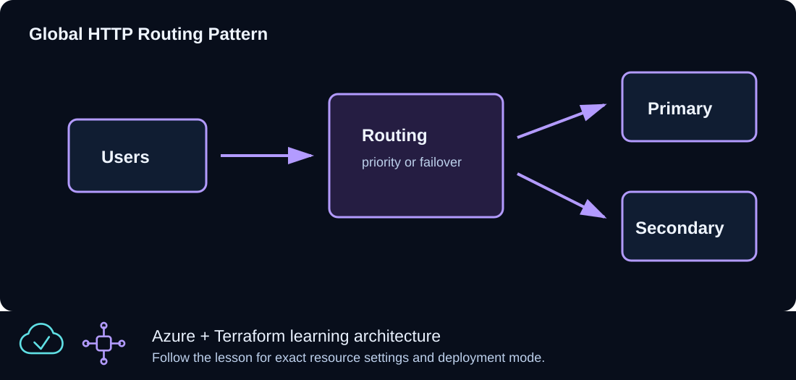

# CLZ-330 - Traffic Manager Global Routing



## Goal

Route clients to two real HTTPS endpoints with priority-based Azure Traffic Manager and understand when an application-layer Azure Front Door design is the better fit.

## Prerequisites

- Complete CLZ-200 or provide two independently reachable HTTPS endpoint FQDNs.
- Both endpoints must be distinct, publicly resolvable, and return a healthy response on port 443 path `/`.
- Do not use `example.com` placeholders for deployment.

## Architecture

Traffic Manager publishes a globally unique DNS name with a stable random suffix. DNS priority routing returns the primary healthy endpoint and fails over to the secondary based on HTTPS probes. Traffic Manager does not proxy traffic, terminate TLS, cache content, or provide WAF.

The distinct-endpoint `check` reports a warning without blocking apply. Stop and resolve warnings before applying. To browse through the profile hostname over HTTPS, the endpoint must also serve that hostname with a valid certificate and correct host routing; an `Online` probe alone does not prove that configuration.

## Resources And Cost

**Relative cost: Low.** Traffic Manager charges by DNS query and endpoint health check; the external endpoints have their own costs.

| Component | Purpose and principal cost driver |
|---|---|
| Traffic Manager profile | Priority routing, 60-second DNS TTL, and HTTPS health monitor. |
| Two external endpoints | Primary priority 1 and secondary priority 2. |
| Stable random suffix | Persists global profile-name uniqueness in Terraform state. |
| Resource group | Lifecycle boundary; Traffic Manager itself is global. |

## Inputs

| Input | Required substitution or decision |
|---|---|
| `subscription_id` | Required for Azure plan, apply, and destroy; use the exact subscription GUID. |
| `environment` | Keep `dev` for an ephemeral lab unless testing another environment boundary. |
| `location` | Choose a supported region with sufficient quota. |
| `name_prefix` | Use a short lowercase prefix for derived names. |
| `primary_endpoint_fqdn` | Required real hostname for the preferred healthy HTTPS service; enter only the host, not `https://`. |
| `secondary_endpoint_fqdn` | Required distinct hostname for failover; it must also serve healthy HTTPS `/`. |

Keep real subscription IDs, CIDRs, endpoint names, and secrets in untracked local files or protected repository settings.

## Deploy

Run from the repository root in PowerShell 7:

```powershell
Set-Location CLZ-330-traffic-manager-or-front-door
if (-not (Test-Path terraform.tfvars)) {
  Copy-Item terraform.tfvars.example terraform.tfvars
}
$subscriptionId = az account show --query id --output tsv
terraform init -lockfile=readonly
terraform fmt -check
terraform validate
terraform plan -var "subscription_id=$subscriptionId" -out tfplan
terraform show tfplan
terraform apply tfplan
```

## Validate

```powershell
$profile = terraform output -raw traffic_manager_profile_name
$fqdn = terraform output -raw traffic_manager_fqdn
Resolve-DnsName $fqdn
# Run only after configuring the profile hostname and its TLS certificate on the endpoints:
Invoke-WebRequest -Uri "https://$fqdn/" -UseBasicParsing | Select-Object StatusCode,BaseResponse
az network traffic-manager endpoint list --resource-group (terraform output -raw resource_group_name) --profile-name $profile --type externalEndpoints --query '[].{name:name,target:target,status:endpointMonitorStatus,priority:priority}' --output table
```

Expected result:

- The profile name/FQDN include a persisted suffix and remain stable across no-change plans.
- DNS resolves through Traffic Manager to the primary healthy endpoint.
- Both endpoint monitor states become `Online`; failover follows priority after DNS/health timing.

## Troubleshooting

| Symptom | Resolution |
|---|---|
| An endpoint remains Degraded | Test public HTTPS `/`, certificate validity, status code, firewall policy, and the exact host name. |
| HTTPS through the profile hostname fails while probes are Online | Configure that hostname and a valid certificate at the endpoint. Do not bypass TLS validation. |
| Failover appears slow | Account for probe detection, the profile TTL, and client/recursive resolver caching. |
| The FQDN changes unexpectedly | Check whether `random_string.suffix` state was lost or intentionally replaced. |

## Cleanup

```powershell
$resourceGroup = terraform output -raw resource_group_name
terraform destroy -var "subscription_id=$subscriptionId"
az group exists --name $resourceGroup
```

The Traffic Manager DNS name and endpoints stop existing; external endpoint services remain because this lesson does not own them.

## Production Delta

- Choose Traffic Manager for DNS-level global routing to endpoints clients can reach directly.
- Choose Azure Front Door when you need an anycast reverse proxy, managed TLS, WAF, path routing, caching, or origin shielding.
- Tune probes/TTL, add alerting, test regional failure, and control endpoint registration through reviewed automation.

## Exercises

1. Disable the primary endpoint service in a safe environment and measure detection plus DNS-cache delay.
2. Write a short decision record comparing Traffic Manager and Front Door for one real application.

## Navigation

<!-- lesson-navigation:start -->
[&larr; CLZ-320 - Cross-Environment State](../CLZ-320-cross-environment-state/README.md) | [Curriculum](../README.md#curriculum) | [CLZ-340 - Key Vault Secrets &rarr;](../CLZ-340-key-vault-secrets/README.md)
<!-- lesson-navigation:end -->
