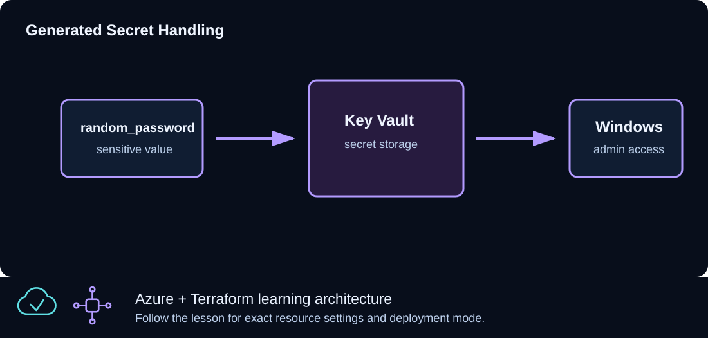

# CLZ-340 - Key Vault Secrets



## Goal

Generate a strong Windows administrator password, store it in a uniquely named Key Vault, expose only safe metadata, and keep secret material out of normal command output.

## Prerequisites

- Complete CLZ-130.
- Permission to create Key Vaults and manage secrets.
- Your current public IPv4 expressed as a `/32` for the lab vault firewall.

## Architecture

A stable random suffix makes the vault name globally unique. Terraform generates the password, creates a Standard vault restricted to the supplied IPv4, grants the current identity lab secret permissions, and writes one secret. The value remains sensitive but is still present in state.

## Resources And Cost

**Relative cost: Low.** Standard Key Vault operations and secret storage are low cost; private endpoints, HSM-backed keys, and high transaction volume add cost.

| Component | Purpose and principal cost driver |
|---|---|
| Key Vault | Standard tier, soft delete, firewall default deny, and a stable unique name. |
| Generated password and secret | Strong random value stored as `windows-admin-password` and in Terraform state. |
| Access policy | Grants the applying identity the permissions needed for this disposable lesson. |
| Stable random suffix | Prevents global naming collisions without changing on every plan. |

## Inputs

| Input | Required substitution or decision |
|---|---|
| `subscription_id` | Required for Azure plan, apply, and destroy; use the exact subscription GUID. |
| `environment` | Keep `dev` for an ephemeral lab unless testing another environment boundary. |
| `location` | Choose a supported region with sufficient quota. |
| `name_prefix` | Use a short lowercase prefix for derived names. |
| `key_vault_access_cidr` | Required current public IPv4 `/32`; broad CIDRs are rejected. |

Keep real subscription IDs, CIDRs, endpoint names, and secrets in untracked local files or protected repository settings.

## Deploy

Run from the repository root in PowerShell 7:

```powershell
Set-Location CLZ-340-key-vault-secrets
if (-not (Test-Path terraform.tfvars)) {
  Copy-Item terraform.tfvars.example terraform.tfvars
}
$subscriptionId = az account show --query id --output tsv
terraform init -lockfile=readonly
terraform fmt -check
terraform validate
terraform plan -var "subscription_id=$subscriptionId" -out tfplan
terraform show tfplan
terraform apply tfplan
```

## Validate

```powershell
$vault = terraform output -raw key_vault_name
az keyvault show --name $vault --query '{name:name,state:properties.provisioningState,publicAccess:properties.publicNetworkAccess,purgeProtection:properties.enablePurgeProtection}' --output json
az keyvault secret show --vault-name $vault --name (terraform output -raw secret_name) --query '{id:id,enabled:attributes.enabled}' --output json
terraform output
```

Expected result:

- The vault has the stable suffixed name and reaches `Succeeded`.
- Secret metadata is readable from the admitted `/32`; validation never prints the value.
- Ordinary Terraform output marks secret-bearing data sensitive.

## Troubleshooting

| Symptom | Resolution |
|---|---|
| Key Vault returns Forbidden | Confirm the active identity, access policy propagation, current public IP, and firewall `/32`. |
| The name is unavailable | Keep state intact so the random suffix remains stable; do not hand-edit the generated name. |
| The vault is soft-deleted after an earlier run | Recover/purge only in the disposable lab scope and respect organization retention policy. |

## Cleanup

```powershell
$resourceGroup = terraform output -raw resource_group_name
$vault = terraform output -raw key_vault_name
terraform destroy -var "subscription_id=$subscriptionId"
az group exists --name $resourceGroup
```

The resource group is gone. Azure may retain a soft-deleted vault name for the configured retention period.

## Production Delta

- Intentional lab exception: enable purge protection and do not grant routine purge permission.
- Prefer Azure RBAC, private endpoints, managed identities, rotation/expiration, diagnostic logs, and separation of secret administration from consumers.
- Treat Terraform state as secret-bearing and protect its backend accordingly.

## Exercises

1. Inspect secret metadata without retrieving its value and explain why that is safer for logs.
2. Rotate the generated secret in a disposable plan and identify every state/security implication.

## Navigation

<!-- lesson-navigation:start -->
[&larr; CLZ-330 - Traffic Manager Global Routing](../CLZ-330-traffic-manager-or-front-door/README.md) | [Curriculum](../README.md#curriculum) | [CLZ-350 - Private Endpoint for Storage &rarr;](../CLZ-350-private-endpoint-storage/README.md)
<!-- lesson-navigation:end -->
