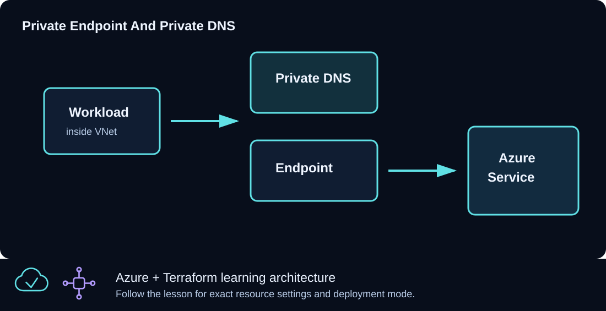

# CLZ-350 - Private Endpoint for Storage



## Goal

Disable public Storage access and connect the blob service to a data subnet through a Private Endpoint and linked Private DNS zone.

## Prerequisites

- Complete CLZ-290.
- Permission to create Storage, Private Endpoint, Private DNS, and VNet resources.
- For data-plane validation, an existing test client inside the linked VNet or a connected network is required; this lesson does not create one.

## Architecture

A uniquely named Storage account denies public network access. Its blob subresource receives a Private Endpoint NIC in the data subnet. A `privatelink.blob.core.windows.net` zone, VNet link, and zone group make the normal service hostname resolve to that private address for in-VNet clients.

## Resources And Cost

**Relative cost: Low.** Private Endpoint has an hourly/data charge; Storage capacity/transactions and Private DNS queries also apply.

| Component | Purpose and principal cost driver |
|---|---|
| Storage account | Standard LRS, TLS 1.2, no anonymous containers, public network access disabled. |
| Blob Private Endpoint | Private IP in `data-snet` and an approved service connection. |
| Private DNS zone, link, and zone group | Maps the public service hostname through `privatelink` to the endpoint. |
| VNet and subnets | Resolution and private-connectivity scope. |

## Inputs

| Input | Required substitution or decision |
|---|---|
| `subscription_id` | Required for Azure plan, apply, and destroy; use the exact subscription GUID. |
| `environment` | Keep `dev` for an ephemeral lab unless testing another environment boundary. |
| `location` | Choose a supported region with sufficient quota. |
| `name_prefix` | Use a short lowercase prefix for derived names. |

Keep real subscription IDs, CIDRs, endpoint names, and secrets in untracked local files or protected repository settings.

## Deploy

Run from the repository root in PowerShell 7:

```powershell
Set-Location CLZ-350-private-endpoint-storage
if (-not (Test-Path terraform.tfvars)) {
  Copy-Item terraform.tfvars.example terraform.tfvars
}
$subscriptionId = az account show --query id --output tsv
terraform init -lockfile=readonly
terraform fmt -check
terraform validate
terraform plan -var "subscription_id=$subscriptionId" -out tfplan
terraform show tfplan
terraform apply tfplan
```

## Validate

```powershell
$resourceGroup = terraform output -raw resource_group_name
$account = terraform output -raw storage_account_name
az network private-endpoint show --ids (terraform output -raw private_endpoint_id) --query '{state:provisioningState,connection:privateLinkServiceConnections[0].privateLinkServiceConnectionState.status,ip:customDnsConfigs[0].ipAddresses[0]}' --output json
az storage account show --resource-group $resourceGroup --name $account --query publicNetworkAccess --output tsv
# Run the next two commands only from a client in the linked VNet:
Resolve-DnsName "$account.blob.core.windows.net"
Test-NetConnection "$account.blob.core.windows.net" -Port 443
```

Expected result:

- Control plane: endpoint provisioning is `Succeeded`, connection is `Approved`, and Storage public network access is `Disabled`.
- Data plane in the VNet: the standard blob FQDN resolves to a private `10.40.3.x` address and TCP 443 succeeds.
- A normal Internet laptop is expected to fail the private data-plane test unless connected to the VNet and using the correct DNS path.

## Troubleshooting

| Symptom | Resolution |
|---|---|
| Azure shows Approved but DNS returns a public IP | Run inside the linked VNet and inspect the zone group, VNet link, custom DNS forwarding, and resolver cache. |
| The laptop cannot access Storage | That is expected with public access disabled; use an in-VNet/connected client. |
| The endpoint is Pending | Inspect connection approval and the correct `blob` subresource selection. |

## Cleanup

```powershell
$resourceGroup = terraform output -raw resource_group_name
terraform destroy -var "subscription_id=$subscriptionId"
az group exists --name $resourceGroup
```

The endpoint, private DNS records/link, Storage account, network, and resource group are deleted.

## Production Delta

- Use centralized Private DNS/resolver architecture, least-privilege data roles, lifecycle/recovery policy, logging, and controlled egress.
- Add zone-redundant or geo-redundant storage only after matching durability and cost requirements.
- Control-plane success is not an availability test; continuously validate DNS and TLS from representative private clients.

## Exercises

1. From an in-VNet client, record the CNAME/A chain for the blob FQDN.
2. Explain why disabling public network access before private DNS is correct only when a private validation path already exists.

## Navigation

<!-- lesson-navigation:start -->
[&larr; CLZ-340 - Key Vault Secrets](../CLZ-340-key-vault-secrets/README.md) | [Curriculum](../README.md#curriculum) | [CLZ-360 - Azure Monitor and Log Analytics &rarr;](../CLZ-360-azure-monitor-log-analytics/README.md)
<!-- lesson-navigation:end -->
