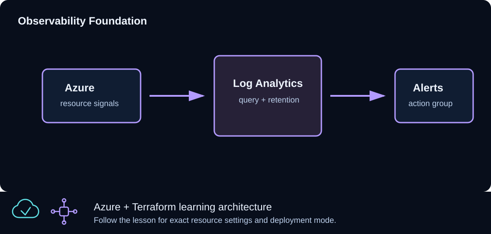

# CLZ-360 - Azure Monitor and Log Analytics



## Goal

Create the operations foundation for centralized logs and notifications, then distinguish a provisioned workspace from a workload that is actually sending data.

## Prerequisites

- Complete CLZ-120.
- Permission to create Log Analytics workspaces and action groups.
- Choose nonproduction notification details before enabling real receivers.

## Architecture

A Log Analytics workspace provides the query/data boundary and retention setting. An Azure Monitor action group supplies an operations notification target. No VM diagnostic setting or data-collection rule is attached, so an empty workspace is expected immediately after deployment.

## Resources And Cost

**Relative cost: Low.** Log ingestion and retention drive cost; the empty workspace/action group are inexpensive.

| Component | Purpose and principal cost driver |
|---|---|
| Log Analytics workspace | Analytics store and query scope; ingestion/retention are the principal drivers. |
| Monitor action group | Reusable notification target; receiver services may have separate limits/costs. |
| Resource group | Owns the operations foundation. |

## Inputs

| Input | Required substitution or decision |
|---|---|
| `subscription_id` | Required for Azure plan, apply, and destroy; use the exact subscription GUID. |
| `environment` | Keep `dev` for an ephemeral lab unless testing another environment boundary. |
| `location` | Choose a supported region with sufficient quota. |
| `name_prefix` | Use a short lowercase prefix for derived names. |

Keep real subscription IDs, CIDRs, endpoint names, and secrets in untracked local files or protected repository settings.

## Deploy

Run from the repository root in PowerShell 7:

```powershell
Set-Location CLZ-360-azure-monitor-log-analytics
if (-not (Test-Path terraform.tfvars)) {
  Copy-Item terraform.tfvars.example terraform.tfvars
}
$subscriptionId = az account show --query id --output tsv
terraform init -lockfile=readonly
terraform fmt -check
terraform validate
terraform plan -var "subscription_id=$subscriptionId" -out tfplan
terraform show tfplan
terraform apply tfplan
```

## Validate

```powershell
$resourceGroup = terraform output -raw resource_group_name
$workspaceId = terraform output -raw log_analytics_workspace_id
az monitor log-analytics workspace show --ids $workspaceId --query '{name:name,state:provisioningState,retention:retentionInDays}' --output table
az monitor action-group list --resource-group $resourceGroup --query '[].{name:name,enabled:enabled}' --output table
az monitor log-analytics query --workspace $workspaceId --analytics-query 'Heartbeat | take 5' --output table
```

Expected result:

- The workspace is `Succeeded` with the configured retention.
- The action group exists and is enabled.
- The Heartbeat query may be empty because this lesson deliberately attaches no data source.

## Troubleshooting

| Symptom | Resolution |
|---|---|
| The query is empty | Expected until a VM/agent and data-collection rule send data; provisioning alone does not create telemetry. |
| Log query returns authorization failure | Verify workspace query/read roles and the selected tenant. |
| Notifications do not arrive | An action group alone does nothing; connect it to an alert rule and verify receiver configuration. |

## Cleanup

```powershell
$resourceGroup = terraform output -raw resource_group_name
terraform destroy -var "subscription_id=$subscriptionId"
az group exists --name $resourceGroup
```

Workspace and action group are removed; consider workspace soft-delete/recovery behavior if names are reused.

## Production Delta

- Define data-collection rules, diagnostic settings, retention/archive, daily caps, alert rules, workbooks, RBAC, and incident ownership.
- Treat alert delivery as a tested service with severity, deduplication, escalation, and maintenance controls.

## Exercises

1. Write a KQL query that would summarize Heartbeat by computer once a source is attached.
2. Design one actionable alert and identify its signal, threshold, window, receiver, and runbook.

## Navigation

<!-- lesson-navigation:start -->
[&larr; CLZ-350 - Private Endpoint for Storage](../CLZ-350-private-endpoint-storage/README.md) | [Curriculum](../README.md#curriculum) | [CLZ-370 - GitHub Actions for Terraform &rarr;](../CLZ-370-github-actions-terraform/README.md)
<!-- lesson-navigation:end -->
