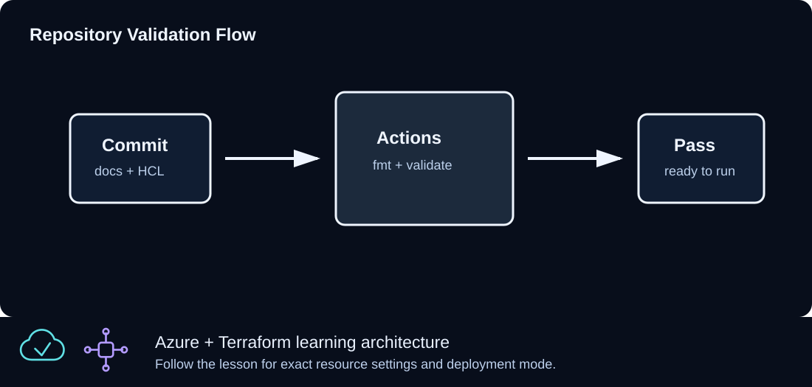

# CLZ-370 - GitHub Actions for Terraform



## Goal

Separate credential-free pull-request validation from a manually triggered Azure OIDC plan, with immutable action pins, least permissions, timeouts, concurrency, and no apply step. The Terraform target is one tagged resource group, but neither example creates it.

## Prerequisites

- Complete CLZ-120 and understand saved-plan review.
- A GitHub repository is needed only if you enable the examples.
- For OIDC, an Azure application/federated credential and GitHub environment approval must be configured by an authorized owner.

## Architecture

The validation example runs checkout, Terraform setup, backend-free initialization, formatting, and validation on pull requests without Azure credentials. The separate manual workflow requests an OIDC token, signs in through `azure/login`, and plans one tagged resource group in the protected `azure-lab-plan` environment. It never applies that plan.

## Resources And Cost

**Relative cost: None when the examples are used as written.** The workflows create no Azure resource. GitHub-hosted runner minutes depend on repository plan and usage; manually applying the lesson outside the examples would create the otherwise no-charge resource group.

| Component | Purpose and principal cost driver |
|---|---|
| Credential-free workflow example | Pull-request validation with read-only repository permission. |
| Manual OIDC plan example | `workflow_dispatch`, `id-token: write`, environment gate, and no apply. |
| Pinned third-party actions | Full commit SHAs for immutable checkout, Terraform setup, and Azure login behavior. |
| Plan-only resource-group target | Gives the OIDC plan one small Azure change to evaluate; it is not applied. |

## Inputs

| Input | Required substitution or decision |
|---|---|
| `AZURE_CLIENT_ID` | GitHub environment/repository variable for the federated application's client ID. |
| `AZURE_TENANT_ID` | Variable for the Entra tenant ID. |
| `AZURE_SUBSCRIPTION_ID` | Variable for the exact plan subscription; never select by display name. |
| `azure-lab-plan` | Create this GitHub environment and add required reviewers before enabling the OIDC plan. |

Keep real subscription IDs, CIDRs, endpoint names, and secrets in untracked local files or protected repository settings.

## Deploy

Run from the repository root in PowerShell 7:

```powershell
Set-Location CLZ-370-github-actions-terraform
terraform init -backend=false -lockfile=readonly
terraform fmt -check
terraform validate
actionlint .github/workflows/terraform-validate.yml.example
actionlint .github/workflows/terraform-plan-oidc.yml.example
# From the repository root, copy only the example you intend to enable:
Set-Location ..
Copy-Item CLZ-370-github-actions-terraform/.github/workflows/terraform-validate.yml.example .github/workflows/lesson-terraform-validate.yml
```

Enabling the credential-free validation example is safe after path review. Do not enable the OIDC example until the environment, federated identity, variables, scope, and approval policy exist.

## Validate

```powershell
actionlint CLZ-370-github-actions-terraform/.github/workflows/terraform-validate.yml.example
actionlint CLZ-370-github-actions-terraform/.github/workflows/terraform-plan-oidc.yml.example
Select-String -Path CLZ-370-github-actions-terraform/.github/workflows/*.example -Pattern 'terraform apply|client-secret'
Select-String -Path CLZ-370-github-actions-terraform/.github/workflows/terraform-plan-oidc.yml.example -Pattern 'terraform plan'
```

Expected result:

- Both example workflows pass `actionlint`.
- The search returns no apply step or client secret.
- Credential-free local/PR checks stop at formatting and validation. The authenticated OIDC workflow contains one plan step for the tagged resource-group target and remains plan-only.

## Troubleshooting

| Symptom | Resolution |
|---|---|
| GitHub reports an invalid workflow after copying | Keep the `.yml` extension, preserve indentation, and confirm referenced working directories exist from repository root. |
| OIDC login fails | Match issuer/subject/audience in the federated credential and verify all three GitHub variables. |
| Plan is forbidden | Grant only the required role at the intended scope and confirm environment approval selected the correct subscription. |

## Cleanup

```powershell
Remove-Item .github/workflows/lesson-terraform-validate.yml -ErrorAction SilentlyContinue
Remove-Item tfplan -ErrorAction SilentlyContinue
terraform state list
```

There are no Azure resources to destroy. Remove test workflow copies or federated credentials separately if you created them.

## Production Delta

- Pin actions to reviewed full commit SHAs, use Dependabot/manual review for updates, and minimize `GITHUB_TOKEN` plus Azure permissions.
- Require environment reviewers for cloud plans/applies, separate identities and workflows, protect branches, retain sanitized artifacts briefly, and never persist plan secrets.
- Keep apply as a separately approved operation; this lesson intentionally provides none.

## Exercises

1. Enable the credential-free example on a branch and observe one passing and one intentionally failing format check.
2. Draft the exact OIDC subject for the `azure-lab-plan` environment and have an authorized reviewer verify its scope.

## Navigation

<!-- lesson-navigation:start -->
[&larr; CLZ-360 - Azure Monitor and Log Analytics](../CLZ-360-azure-monitor-log-analytics/README.md) | [Curriculum](../README.md#curriculum) | [CLZ-380 - Azure SQL Private Access &rarr;](../CLZ-380-azure-sql-private-access/README.md)
<!-- lesson-navigation:end -->
