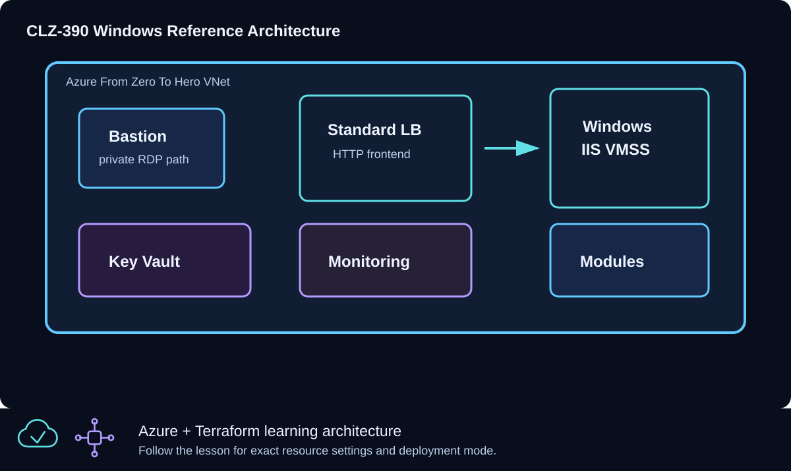

# CLZ-390 - Final Windows Reference Architecture



## Goal

Combine reusable network and Windows VMSS modules with a Standard Load Balancer, explicit outbound behavior, subnet NSG, Azure Bastion, Key Vault, and Log Analytics into one reviewable capstone.

## Prerequisites

- Complete CLZ-210, CLZ-260, CLZ-340, and CLZ-360.
- Quota and budget for Bastion plus the selected VMSS maximum size/count.
- Your current public IPv4 `/32` for Key Vault access.
- Destroy older capstone deployments before adopting the suffixed Key Vault name.

## Architecture

The network module creates the VNet and workload subnets. A web-subnet NSG admits public HTTP for the Standard Load Balancer path and RDP only from `AzureBastionSubnet`. The VMSS module supplies IIS, probe, inbound rule, and explicit outbound rule. Bastion provides private administration; Key Vault stores the generated credential; Log Analytics creates the observability boundary.

## Resources And Cost

**Relative cost: High.** Bastion and VMSS instances dominate; disks, public IPs, Log Analytics ingestion, Key Vault operations, and outbound traffic also contribute.

| Component | Purpose and principal cost driver |
|---|---|
| Network module and web NSG | VNet/subnets plus explicit HTTP and Bastion-only RDP policy. |
| Windows IIS VMSS module | Validated size/count, Standard Load Balancer, health probe, and explicit outbound rule. |
| Azure Bastion and public IP | Private RDP management path with an hourly charge. |
| Key Vault and generated secret | Stable suffixed vault restricted to the supplied `/32`; sensitive value remains in state. |
| Log Analytics workspace | Monitoring foundation; ingestion/retention determines ongoing cost. |

## Inputs

| Input | Required substitution or decision |
|---|---|
| `subscription_id` | Required for Azure plan, apply, and destroy; use the exact subscription GUID. |
| `environment` | Keep `dev` for an ephemeral lab unless testing another environment boundary. |
| `location` | Choose a supported region with sufficient quota. |
| `name_prefix` | Use a short lowercase prefix for derived names. |
| `admin_username` | Nonreserved administrator name used by VMSS. |
| `vm_size` | Small Windows size supported in the selected region. |
| `instance_count` | Positive integer; keep the capstone small because it multiplies VM/disk cost. |
| `key_vault_access_cidr` | Required current public IPv4 `/32` for lab secret administration. |

Keep real subscription IDs, CIDRs, endpoint names, and secrets in untracked local files or protected repository settings.

## Deploy

Run from the repository root in PowerShell 7:

```powershell
Set-Location CLZ-390-final-windows-reference-architecture
if (-not (Test-Path terraform.tfvars)) {
  Copy-Item terraform.tfvars.example terraform.tfvars
}
$subscriptionId = az account show --query id --output tsv
terraform init -lockfile=readonly
terraform fmt -check
terraform validate
terraform plan -var "subscription_id=$subscriptionId" -out tfplan
terraform show tfplan
terraform apply tfplan
```

## Validate

```powershell
$resourceGroup = terraform output -raw resource_group_name
$url = terraform output -raw capstone_load_balancer_url
(Invoke-WebRequest -Uri $url -UseBasicParsing).StatusCode
$nsg = terraform output -raw web_network_security_group_name
az network nsg rule list --resource-group $resourceGroup --nsg-name $nsg --query '[].{name:name,source:sourceAddressPrefix,port:destinationPortRange,access:access}' --output table
az network bastion list --resource-group $resourceGroup --query '[].provisioningState' --output tsv
az keyvault show --name (terraform output -raw key_vault_name) --query properties.provisioningState --output tsv
$lb = az network lb list --resource-group $resourceGroup --query '[0].name' -o tsv
az network lb outbound-rule list --resource-group $resourceGroup --lb-name $lb --output table
```

Expected result:

- HTTP returns `200` through the Load Balancer and healthy VMSS.
- The web NSG contains the HTTP path and RDP is restricted to the Bastion subnet rather than an Internet CIDR.
- Bastion and Key Vault are `Succeeded`, and the Load Balancer has an explicit outbound rule.

## Troubleshooting

| Symptom | Resolution |
|---|---|
| HTTP fails after apply | Wait for VMSS extension/probe health, then inspect NSG, backend pool, and instance view. |
| Bastion cannot reach an instance | Check the Bastion subnet, web NSG RDP source, VMSS instance health, and credentials. |
| Key Vault returns Forbidden | Update the required `/32`, verify applying identity/policy, and allow propagation time. |

## Cleanup

```powershell
$resourceGroup = terraform output -raw resource_group_name
terraform destroy -var "subscription_id=$subscriptionId"
terraform state list
az group exists --name $resourceGroup
```

All high-cost Bastion, VMSS, Load Balancer, public IP, disk, vault, workspace, and network resources are removed; Azure CLI returns `false`.

## Production Delta

- Enable Key Vault purge protection, RBAC/private access, managed identity secret retrieval, rotation, and protected remote state.
- Add filtered egress, TLS/application gateway or Front Door as required, hardened images, patching, backup, zone resilience, autoscale, diagnostics, alerts, and tested recovery.
- Split platform, network, security, data, and workload lifecycles/states with reviewed module versions and least-privilege deployment identities.

## Exercises

1. Use CLI-only evidence to prove every acceptance criterion without relying on the portal.
2. Produce a production gap list ranked by security risk, availability impact, operational effort, and cost.

## Navigation

<!-- lesson-navigation:start -->
[&larr; CLZ-380 - Azure SQL Private Access](../CLZ-380-azure-sql-private-access/README.md) | [Curriculum](../README.md#curriculum) | [Curriculum &rarr;](../README.md#curriculum)
<!-- lesson-navigation:end -->
