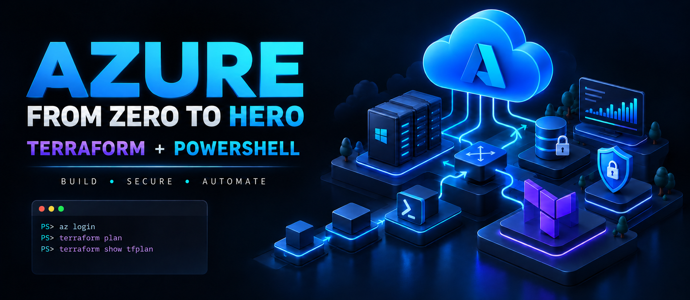
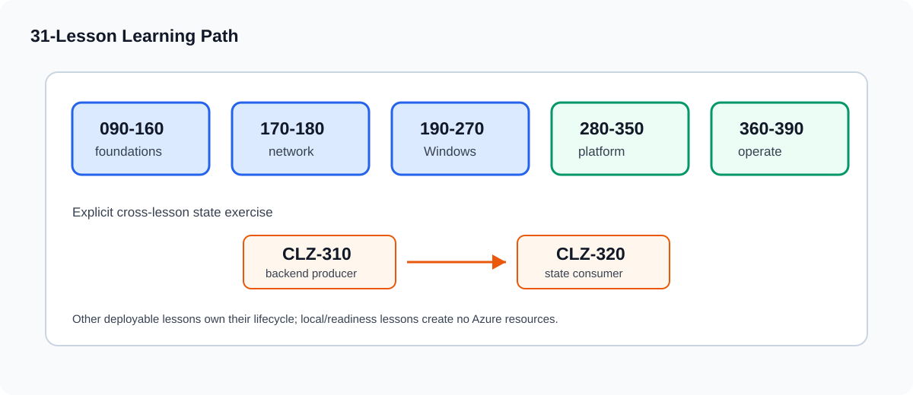

# Azure From Zero To Hero

[](https://github.com/Jamonygr/Azure-From-Zero-To-Hero/actions/workflows/terraform-validate.yml)



Original conceptual cover illustration. [Open the cover at full size](assets/illustrations/zero-to-hero-cover.png).

A Windows-first path from Terraform fundamentals to a private, monitored Azure
reference architecture. The 31 lessons use PowerShell, Azure CLI, Terraform,
Windows Server, IIS, networking, state, security, operations, and CI.

**[Open the illustrated learning website](https://jamonygr.github.io/Azure-From-Zero-To-Hero/)** ·
[Practice 900 original questions](https://jamonygr.github.io/Azure-From-Zero-To-Hero/practice/) ·
[Download Beyond Clickopz](ClickopzBook.pdf)

The website brings together all 31 lessons, six learning phases, 55 SVG teaching
visuals, search, quizzes with explanations, and browser-local progress. Black/navy
is the default theme, with a remembered light-mode option. Exercise and cleanup
completion are self-reported; the website does not run Terraform or create Azure resources.

> [!CAUTION]
> Many lessons create billable Azure resources. Nothing in this repository runs
> `terraform apply` for you. Read the plan, use an explicit subscription ID, and
> destroy each lab unless its README identifies a downstream dependency.

## Quickstart

Clone the repository and open it in PowerShell 7:

```powershell
git clone https://github.com/Jamonygr/Azure-From-Zero-To-Hero.git
Set-Location Azure-From-Zero-To-Hero
code .
```

Audit the workstation without installing or changing anything:

```powershell
pwsh --version
terraform version
az version
git --version
code --version
./scripts/Test-AzureFromZeroToHeroToolchain.ps1 -Profile Learner
```

Start with [CLZ-100](CLZ-100-foundations/README.md). It is credential-free and
does not deploy Azure resources. Use the optional [CLZ-090 contributor setup](CLZ-090-optional-vscode-terraform-powershell-setup/README.md)
first when the local toolchain is incomplete.

Before the first deployment, complete [CLZ-110](CLZ-110-windows-workstation-setup/README.md)
and verify the active tenant, subscription, permissions, regional availability,
and quota. [CLZ-120](CLZ-120-terraform-core-workflow/README.md) is the first
lesson that creates an Azure resource.

## Safe Azure Context

Never select a subscription by display name in automation. Capture its ID,
inspect it, and pass it explicitly to Terraform:

```powershell
az login
az account list --output table
az account set --subscription '<subscription-id>'
$subscriptionId = az account show --query id --output tsv
az account show --query '{tenant:tenantId,subscription:id,user:user.name}' --output table
```

For a deployable lesson, follow its README. The standard shape is:

```powershell
Copy-Item terraform.tfvars.example terraform.tfvars
terraform init -lockfile=readonly
terraform fmt -check
terraform validate
terraform plan -var "subscription_id=$subscriptionId" -out tfplan
terraform show tfplan
terraform apply tfplan
terraform destroy -var "subscription_id=$subscriptionId"
```

Do not commit `terraform.tfvars`, plan files, state files, or output containing
secrets.

## Dependency Map



| Path | Dependency rule |
|---|---|
| CLZ-090 → 100 → 110 → 120 | Optional contributor setup, local foundations, read-only Azure readiness, then first deployment |
| CLZ-170 → 180 → 190 → 200 | Network, security rules, first Windows VM, then IIS automation |
| CLZ-220 → 260 → 270 | Load-balancing concepts before manual and automatic VMSS scaling |
| CLZ-310 → backend migration → 320 | Keep CLZ-310 state storage alive until CLZ-320 is destroyed and state is migrated back |
| CLZ-290 → 350 → 380 | Private DNS before private Storage and SQL endpoints |
| CLZ-210 + 260 + 340 + 360 → 390 | Bastion, VMSS, Key Vault, and monitoring patterns combine in the capstone |

Most lessons are independently deployed even when their concepts build on an
earlier lesson. CLZ-320 is the important exception: it reads state hosted by
CLZ-310. Follow the [state exercise](CLZ-310-remote-state-storage/README.md)
and clean up in reverse order.

## Curriculum

The catalog in [`curriculum/lessons.psd1`](curriculum/lessons.psd1) is the
source of truth for titles, phases, prerequisites, diagrams, cost tiers,
deployment modes, and navigation.

<!-- curriculum:start -->
| ID | Lesson | Phase | Prerequisites | Cost | Run mode |
|---|---|---|---|---|---|
| CLZ-090 | [CLZ-090 - Optional Windows Contributor Workstation Setup](CLZ-090-optional-vscode-terraform-powershell-setup/README.md) | Workstation | None | None | Local only |
| CLZ-100 | [CLZ-100 - Terraform Foundations](CLZ-100-foundations/README.md) | Foundations | None | None | Local only |
| CLZ-110 | [CLZ-110 - Azure CLI and Subscription Readiness](CLZ-110-windows-workstation-setup/README.md) | Foundations | [CLZ-100](CLZ-100-foundations/README.md) | None | Read-only Azure checks |
| CLZ-120 | [CLZ-120 - First Azure Deployment and Terraform Workflow](CLZ-120-terraform-core-workflow/README.md) | Foundations | [CLZ-110](CLZ-110-windows-workstation-setup/README.md) | Low | Azure deployment |
| CLZ-130 | [CLZ-130 - Provider Authentication](CLZ-130-provider-authentication/README.md) | Foundations | [CLZ-120](CLZ-120-terraform-core-workflow/README.md) | Low | Azure deployment |
| CLZ-140 | [CLZ-140 - Resource Groups and Tags](CLZ-140-resource-groups-tags/README.md) | Foundations | [CLZ-130](CLZ-130-provider-authentication/README.md) | Low | Azure deployment |
| CLZ-150 | [CLZ-150 - Variables, Locals, and Outputs](CLZ-150-variables-locals-outputs/README.md) | Foundations | [CLZ-140](CLZ-140-resource-groups-tags/README.md) | Low | Azure deployment |
| CLZ-160 | [CLZ-160 - State and Locking Basics](CLZ-160-state-and-locking-basics/README.md) | Foundations | [CLZ-150](CLZ-150-variables-locals-outputs/README.md) | Low | Azure deployment |
| CLZ-170 | [CLZ-170 - Virtual Network Foundation](CLZ-170-virtual-network-foundation/README.md) | Networking | [CLZ-160](CLZ-160-state-and-locking-basics/README.md) | Low | Azure deployment |
| CLZ-180 | [CLZ-180 - Network Security Groups](CLZ-180-network-security-groups/README.md) | Networking | [CLZ-170](CLZ-170-virtual-network-foundation/README.md) | Low | Azure deployment |
| CLZ-190 | [CLZ-190 - Windows VM Basics](CLZ-190-windows-vm-basics/README.md) | Windows compute | [CLZ-180](CLZ-180-network-security-groups/README.md) | Moderate | Azure deployment |
| CLZ-200 | [CLZ-200 - Windows VM IIS Bootstrap](CLZ-200-windows-vm-iis-bootstrap/README.md) | Windows compute | [CLZ-190](CLZ-190-windows-vm-basics/README.md) | Moderate | Azure deployment |
| CLZ-210 | [CLZ-210 - Azure Bastion RDP](CLZ-210-azure-bastion-rdp/README.md) | Windows compute | [CLZ-200](CLZ-200-windows-vm-iis-bootstrap/README.md) | High | Azure deployment |
| CLZ-220 | [CLZ-220 - Standard Load Balancer for Windows](CLZ-220-standard-load-balancer-windows/README.md) | Windows compute | [CLZ-210](CLZ-210-azure-bastion-rdp/README.md) | High | Azure deployment |
| CLZ-230 | [CLZ-230 - Load Balancer NAT Rules](CLZ-230-load-balancer-nat-rules/README.md) | Windows compute | [CLZ-220](CLZ-220-standard-load-balancer-windows/README.md) | Moderate | Azure deployment |
| CLZ-240 | [CLZ-240 - Count with Windows VMs](CLZ-240-count-windows-vms/README.md) | Windows compute | [CLZ-230](CLZ-230-load-balancer-nat-rules/README.md) | High | Azure deployment |
| CLZ-250 | [CLZ-250 - For Each with Windows VMs](CLZ-250-for-each-windows-vms/README.md) | Windows compute | [CLZ-240](CLZ-240-count-windows-vms/README.md) | High | Azure deployment |
| CLZ-260 | [CLZ-260 - Windows VMSS Manual Scaling](CLZ-260-windows-vmss-manual-scaling/README.md) | Windows compute | [CLZ-250](CLZ-250-for-each-windows-vms/README.md) | High | Azure deployment |
| CLZ-270 | [CLZ-270 - Windows VMSS Autoscaling](CLZ-270-windows-vmss-autoscaling/README.md) | Windows compute | [CLZ-260](CLZ-260-windows-vmss-manual-scaling/README.md) | High | Azure deployment |
| CLZ-280 | [CLZ-280 - NAT Gateway Outbound](CLZ-280-nat-gateway-outbound/README.md) | Platform services | [CLZ-270](CLZ-270-windows-vmss-autoscaling/README.md) | Moderate | Azure deployment |
| CLZ-290 | [CLZ-290 - Private DNS](CLZ-290-private-dns/README.md) | Platform services | [CLZ-280](CLZ-280-nat-gateway-outbound/README.md) | Low | Azure deployment |
| CLZ-300 | [CLZ-300 - Optional Public DNS](CLZ-300-public-dns-optional/README.md) | Platform services | [CLZ-290](CLZ-290-private-dns/README.md) | Low | Optional Azure deployment |
| CLZ-310 | [CLZ-310 - Remote State Storage](CLZ-310-remote-state-storage/README.md) | Platform services | [CLZ-160](CLZ-160-state-and-locking-basics/README.md) | Low | Azure deployment with migration |
| CLZ-320 | [CLZ-320 - Cross-Environment State](CLZ-320-cross-environment-state/README.md) | Platform services | [CLZ-310](CLZ-310-remote-state-storage/README.md) | Low | Dependent Azure deployment |
| CLZ-330 | [CLZ-330 - Traffic Manager Global Routing](CLZ-330-traffic-manager-or-front-door/README.md) | Platform services | [CLZ-200](CLZ-200-windows-vm-iis-bootstrap/README.md) | Low | Azure deployment |
| CLZ-340 | [CLZ-340 - Key Vault Secrets](CLZ-340-key-vault-secrets/README.md) | Platform services | [CLZ-130](CLZ-130-provider-authentication/README.md) | Low | Azure deployment |
| CLZ-350 | [CLZ-350 - Private Endpoint for Storage](CLZ-350-private-endpoint-storage/README.md) | Platform services | [CLZ-290](CLZ-290-private-dns/README.md) | Low | Azure deployment |
| CLZ-360 | [CLZ-360 - Azure Monitor and Log Analytics](CLZ-360-azure-monitor-log-analytics/README.md) | Operations | [CLZ-120](CLZ-120-terraform-core-workflow/README.md) | Low | Azure deployment |
| CLZ-370 | [CLZ-370 - GitHub Actions for Terraform](CLZ-370-github-actions-terraform/README.md) | Operations | [CLZ-120](CLZ-120-terraform-core-workflow/README.md) | None | CI examples |
| CLZ-380 | [CLZ-380 - Azure SQL Private Access](CLZ-380-azure-sql-private-access/README.md) | Operations | [CLZ-290](CLZ-290-private-dns/README.md), [CLZ-350](CLZ-350-private-endpoint-storage/README.md) | Moderate | Azure deployment |
| CLZ-390 | [CLZ-390 - Final Windows Reference Architecture](CLZ-390-final-windows-reference-architecture/README.md) | Operations | [CLZ-210](CLZ-210-azure-bastion-rdp/README.md), [CLZ-260](CLZ-260-windows-vmss-manual-scaling/README.md), [CLZ-340](CLZ-340-key-vault-secrets/README.md), [CLZ-360](CLZ-360-azure-monitor-log-analytics/README.md) | High | Capstone Azure deployment |
<!-- curriculum:end -->

Regenerate only the marked catalog and lesson-navigation blocks with:

```powershell
./scripts/Sync-AzureFromZeroToHeroCurriculum.ps1 -Check
./scripts/Sync-AzureFromZeroToHeroCurriculum.ps1 -Write
```

## Repository Checks

These checks do not run `terraform plan`, `apply`, provider registration, or
resource changes against Azure:

```powershell
./scripts/Test-AzureFromZeroToHeroTerraform.ps1 -Format -Validate -Test -LockfileReadonly
./scripts/Test-AzureFromZeroToHeroDocs.ps1
./scripts/Test-AzureFromZeroToHeroQuality.ps1
```

Cloud plans remain a deliberate local or manually triggered OIDC action. See
[CLZ-370](CLZ-370-github-actions-terraform/README.md) before enabling one.

## Companion Book

[](ClickopzBook.pdf)

[Beyond Clickopz](ClickopzBook.pdf) is available at no charge for personal
reading. Its existing **all rights reserved** notice still applies: “free” does
not mean public domain or open licensed. This repository does not add or change
the book's legal terms.

The PDF predates some repository paths. Use the
[companion-book errata and crosswalk](wiki/companion-book-errata.md) for current
lesson and workflow locations.

## Maintenance and Help

- [Migration guide](MIGRATION.md) for learners upgrading an existing checkout.
- [Cost and lab safety](wiki/cost-governance-and-lab-safety.md) before paid labs.
- [Troubleshooting](wiki/troubleshooting.md) for common Terraform and Azure errors.
- [Manual Azure smoke matrix](wiki/manual-azure-smoke-matrix.md) for maintainers.
- [Contributing](CONTRIBUTING.md), [support](SUPPORT.md), and [security](SECURITY.md).

No software or book license is added or changed by this overhaul.
