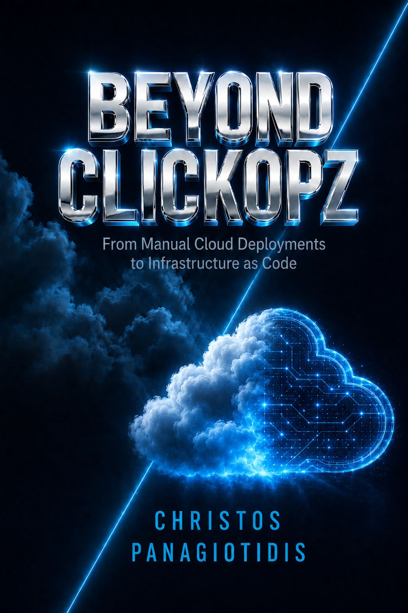

# Beyond Clickopz — companion book

Read the free companion book to explore the move from manual Azure work to
Infrastructure as Code, then use the lessons for guided hands-on practice.

[Download Beyond Clickopz (PDF)](../../ClickopzBook.pdf)

The PDF is available at no charge for personal reading. Its existing **all rights
reserved** notice still applies. This website does not add or change the book's
legal terms or the repository's licensing.

The book predates some repository paths. Use the
[book errata and crosswalk](../../wiki/companion-book-errata.md) for the current lesson
and workflow locations.

[Download all lab sources (GitHub ZIP)](https://github.com/Jamonygr/Azure-From-Zero-To-Hero/archive/refs/heads/main.zip)
